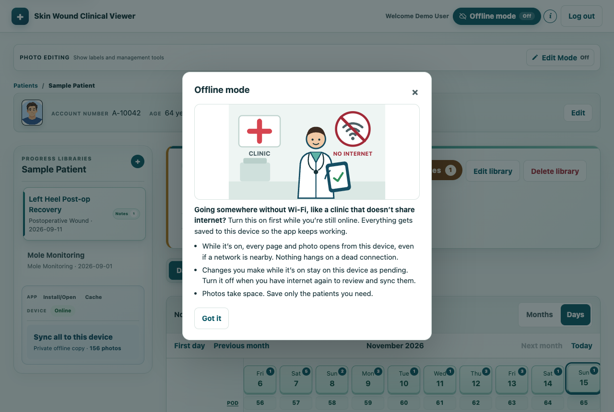

# Offline mode and caching

## Analysis: how caching worked before Offline mode

Everything lives in `index.php`: PHP routes are `?action=` handlers, and the
CSS (`css()`) and JS (`js()`) are inlined into every HTML page. There are no
separate static asset files or web fonts, so every rendered page carries its
own code.

| Piece | Where | What it does |
| --- | --- | --- |
| `APP_VERSION` | `define('APP_VERSION', …)` | First 10 hex chars of `sha1(filemtime:filesize)` of `index.php`. Any edit to the file changes it. |
| `?action=version` | PHP | Returns `{version}` with `no-store`. The page calls it on load, on `pageshow` (bfcache) and on `visibilitychange`, and does a guarded `location.replace` when the server version differs. |
| `?action=manifest` | PHP | Web app manifest (`start_url ./index.php`, scope `./`, icons from `?action=icon`). Linked with `&v=APP_VERSION`. |
| `?action=service-worker` | PHP | Service worker script, `no-store`, registered with `&v=APP_VERSION` and `updateViaCache:'none'`, so every code change installs a new worker. A `controllerchange` triggers one reload. |
| Shell cache `swcv-shell-<version>` | SW `install` | Holds only a metadata entry (`./__swcv-cache-meta`: version + cachedAt). The HTML shell itself was **not** precached. Old versions are deleted on `activate`. |
| Patient caches `swcv-patient-<id>` | page JS `syncAll()` | **Sync all to this device** (sidebar of a patient page) downloads the snapshot JSON, one day page per calendar day per library, a gallery page per library and every full-size photo, for **one** patient. Progress is shown as photos `n / N`. IndexedDB `skin-wound-viewer` → `meta` stores completion per patient. |
| SW `fetch` | SW | Only `GET` same-origin requests. `action=media` is cache-first. Navigations are network-first with a fallback to an exact cached match, then any cached page of any synced patient, then a 503 "Offline" page. Everything else goes straight to the network. |
| Outbox | page JS `stage()` | When `navigator.onLine` is false, form submits (except logout) are serialized (fields + files) into IndexedDB `outbox`. **Review and sync N changes** replays them with `expected_revision` and stops on a 409 conflict. |
| Cache modal (c091572) | footer **App · Cache** | Shows the last shell-cache date and version, per-browser clear steps (with environment detection) and **Clear app cache now** (deletes `swcv-shell-*` and unregisters the SW; keeps patient copies). |
| Logout | PHP | Sends `Clear-Site-Data: "cache", "storage"`. |

Gaps that Offline mode fixes:

1. The front page (patient list) was never cached, so opening `./` or
   `index.php` with no network showed "No synced record".
2. The network-first navigation still needed a real network failure. On a
   clinic Wi-Fi that is connected but has no internet (captive portal, blocked
   uplink) requests hang or return portal pages instead of failing fast.
3. Only one patient at a time could be synced, with no size estimate.
4. `navigator.onLine` is true on captive Wi-Fi, so the outbox never engaged
   and writes could hit a dead network.

## Offline mode (what was added)

**Where:** a primary **Offline mode · Off/On** pill in the header (every signed-in
page) with an **(i)** button, and the same toggle plus a status panel inside
**App · Cache**.

**Turning it on** (needs internet):

1. `GET index.php?action=offline-plan` (signed in) returns, for every patient
   this account can open: page URLs (landing, each library's default day view and
   gallery, every date that has an update or day note, the start date and today),
   the snapshot URL, de-duplicated photo URLs with byte sizes, the shell URLs
   (`index.php`, manifest, icons) and size estimates.
2. The setup dialog lists patients with checkboxes. The current patient is
   preselected on a patient page; on the front page the last saved set (or all)
   is preselected. It measures one real page to estimate size and shows
   `items · about N MB (M still to download) · F free in this browser`. It warns
   above 300 MB or above 80% of free quota, and disables Save when it cannot fit.
3. **Save and turn on** downloads with 4 parallel workers, shows `Saving n of N ·
   size` in a progress bar and on the header chip (`n/N`), skips photos already
   cached (photo URLs are immutable, `&v=` = library revision), and harvests avatar
   and icon URLs from the saved front page and patient landing pages.
   Precache fetches send `X-SWCV-Fill: 1`, which the service worker always lets
   through to the network.
4. Failures are listed. A `QuotaExceededError` stops the run and leaves Offline
   mode **off**. If the front page itself fails, Offline mode stays off.
5. On success the state `{on, at, version, patients, items, bytes, failed}` is
   written to `localStorage['swcv-offline-mode']` **and** to Cache Storage
   (`swcv-offline-state` → `./__swcv-offline-mode`), and posted to the service
   worker.

Caches: `swcv-offline-shell` (front page under both `index.php` and `./`,
manifest, icons, avatars) and the existing per-patient `swcv-patient-<id>`
caches, so **Sync all to this device** and Offline mode share one copy.

**While on**, the service worker answers every same-origin `GET` from Cache
Storage only (cache-only), the front page included:

- Exact match, then a normalized match (`/dir/` = `/dir/index.php`, query
  parameters sorted, `v` and `t` ignored).
- Pages (no `action=`) fall back to the closest saved page of the same patient:
  same library, same view, nearest date. With no `patient` it serves the saved
  front page, so `./`, `index.php` and `index.php?anything` all work.
- A page that was never saved returns a friendly "Not saved for offline use"
  page. A missing asset returns 504. Nothing touches the network.
- The only exception is `?action=version`, which is tried on the network so a
  new release can be detected (falls back to a 503 JSON when offline).

**Turning it off** flips the flag only. The saved copy stays as the existing
network-first fallback and can be removed with the × on the device-copy card.

## Decisions

- **Writes while on are queued, never sent.** Any POST form submit is serialized
  into the existing IndexedDB outbox (fields + files) with `expected_revision`,
  with a "Pending sync" notice. **Review and sync** is blocked while Offline mode
  is on. Turning it off asks to review and sync now. Replay stops on a 409
  conflict and keeps the remaining items. Logout now warns before deleting
  unsynced changes, because logout sends `Clear-Site-Data`.
- **New versions are never trapped.** `APP_VERSION` still changes on every edit
  to `index.php` (mtime + size), the service worker and manifest URLs still carry
  `&v=APP_VERSION`, and the browser fetches the service worker script outside the
  cache. When a page loads online and `?action=version` differs, the page
  re-saves the same patients (pages and data again, photos only if missing), keeps
  Offline mode on and reloads into the new code. A sessionStorage guard prevents
  loops. On failure, the status explains it and **Update offline copy** retries.
- **Only dated pages are saved**, not every calendar day. Dates without updates
  open the nearest saved date of that library. This keeps the copy roughly
  `pages × ~0.5–1 MB + photos`.
- **Size is chosen by the user.** Photos dominate. The picker defaults to the
  current patient, shows per-patient sizes and checks quota up front.
- If the browser evicts the copy, the next load notices the missing front page,
  turns Offline mode off and says why.
- `storage/` and `pipe-in/` stay ignored by git. Screenshots use the sample
  patient only.

## Verification (headless Chrome, test storage copy)

Run against `POSTOP_STORAGE_DIR=/tmp/...` with only the sample patient and a
duplicate test patient, signed in as the public demo account:

- (i) opens the explainer, and Escape closes it.
- The estimate of about 65 MB matched the 66 MB actually saved (98 of 98 items).
- With Offline mode on and the server **running**, navigating a patient page made
  only two server requests: `action=version` and the browser's own service worker
  update check.
- The server was stopped and `setOffline(true)` set. Then `./`, `index.php`,
  `index.php?foo=bar`, `?patient=…`, the library day view and a dated day view all
  rendered with every photo loaded (photo `naturalWidth` 1448). An unsaved patient
  showed "Not saved for offline use".
- A form submit while on was queued in the outbox, not sent.
- Back online, `index.php` was touched to change `APP_VERSION`. The page re-saved
  itself and reloaded on the new version with Offline mode still on.
- After turning it off, navigation hit the server again, and the pending change
  was offered for review and sync.

## Reusing this in another PHP app

1. Add an authenticated `?action=offline-plan` that lists every URL the app
   needs: shell URLs, one page URL per meaningful view, data/JSON URLs, and media
   URLs with byte sizes (de-duplicated). Include a per-page size estimate.
2. In the service worker add: a flag read from
   `caches.open('<app>-offline-state').match('./__<app>-offline-mode')`, cached
   in memory and updated by `postMessage({type:'<app>-offline-mode',on})`; a
   bypass for requests with an `X-<App>-Fill: 1` header; and a `fetch` handler
   that, when the flag is on, answers every same-origin GET from caches (exact,
   then normalized URL, then a best-match page, then a friendly miss page), and
   lets only the version endpoint try the network.
3. In the page add a primary toggle and an (i) `<dialog>` explainer. Turning it
   on opens a picker with an estimate (`navigator.storage.estimate()`), calls
   `navigator.storage.persist()`, fetches every plan URL with the fill header,
   stores bodies with `cache.put`, shows `n of N`, stops on quota errors, and then
   writes the flag to localStorage, Cache Storage and the service worker.
4. While on, queue POSTs (IndexedDB outbox) and block replay until it is turned
   off. On a version mismatch while online, re-save and reload.
5. Keep the version derived from the main file and put it in the service worker
   and manifest URLs so every deploy reaches iPad Safari.
